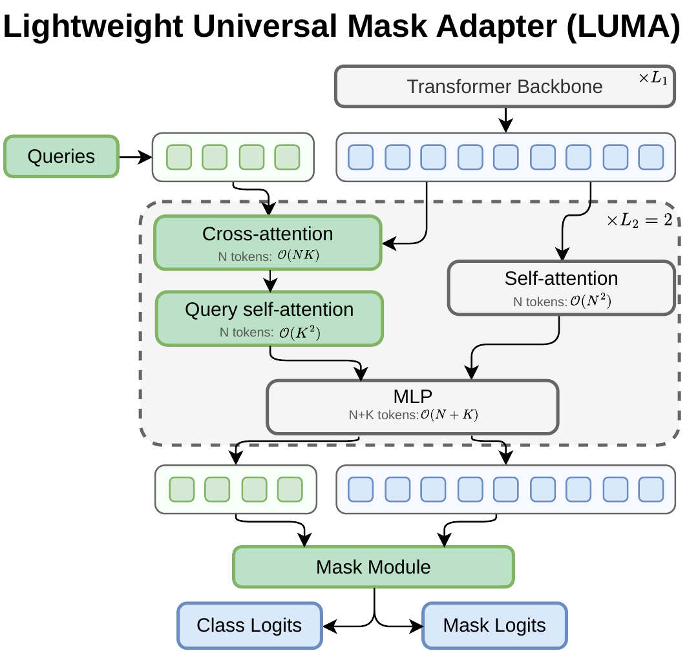
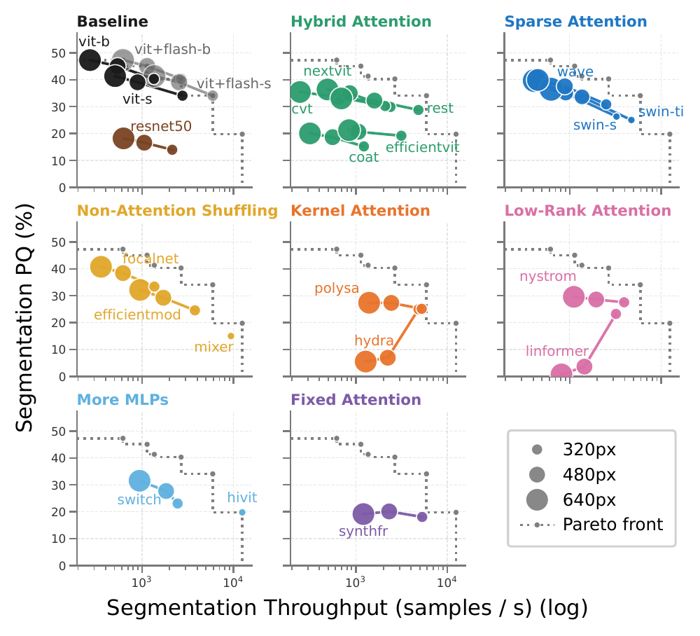

# LUMA: Benchmarking Segmentation via a Lightweight Universal Mask Adapter

[](https://nauen-it.de/publications/luma/)
[](https://arxiv.org/abs/2607.00687)


[](LICENSE)

<p align="center">
  
</p>

This repository contains the official implementation of **LUMA**, the Lightweight Universal Mask Adapter.
LUMA is a mask-transformer segmentation head that attaches to any backbone without modifying it.
We hold it fixed to compare 20 backbones, 11 pretraining schemes and a range of input resolutions on ADE20K, Cityscapes and COCO, all under one training recipe.

The code is built on [EoMT](https://github.com/tue-mps/eomt); see [Acknowledgements](#acknowledgements).

## News

- [21.10.2026] We release the **code** for LUMA in this repository ⚙️
- [01.07.2026] The LUMA **preprint** is published on [arXiv](https://arxiv.org/abs/2607.00687) 🗞️

## Introduction

Comparisons of segmentation backbones are usually confounded: each backbone comes with its own decoder, training recipe, pretraining and resolution.
EoMT showed that a plain ViT needs almost no decoder, because its own self-attention can process the mask queries.
That trick relies on global attention, access to the block internals and a constant token width, so it only works for plain ViTs.

LUMA keeps the queries in a separate stream.
In each of the last two backbone blocks, the queries read the patch features through one cross-attention layer, attend to each other, and then pass through the block's own MLP.
The backbone itself runs exactly as it would on its own.
When a hierarchical backbone changes its width between stages, the queries go through the same projection as the patch tokens.
The same head therefore attaches unchanged to plain, hierarchical, windowed, convolutional and mixture-of-experts backbones.

With a DINOv2 ViT-L backbone, LUMA matches EoMT in accuracy and cost:

| Dataset (val) | Metric | Input | EoMT&#8224; | LUMA | GFLOPs (EoMT / LUMA) | FPS (EoMT / LUMA) |
| ------------- | ------ | ----- | ----------- | ---- | -------------------- | ----------------- |
| ADE20K        | mIoU   | 512²  | 58.4        | 58.6 | 789 / 790            | 150 / 143         |
| Cityscapes    | mIoU   | 1024² | 84.2        | 84.6 | 4350 / 4371          | 36 / 37           |
| COCO          | PQ     | 640²  | 56.0        | 55.8 | 750 / 754            | 128 / 105         |
| COCO          | PQ     | 1280² | 58.3        | 58.3 | 4146 / 4469          | 42 / 32           |
| ADE20K        | PQ     | 640²  | 50.6\*      | 50.4 | 750 / 754            | 128 / 105         |
| ADE20K        | PQ     | 1280² | 51.7\*      | 51.7 | 4146 / 4469          | 30 / 32           |

&#8224; Our re-implementation, measured on the same hardware as LUMA.
\* EoMT's ADE20K panoptic models are first trained on COCO panoptic; LUMA's are not.

With LUMA as the fixed head, the benchmark finds:

- **Backbone:** Plain ViT holds the throughput Pareto front at every resolution, even without FlashAttention. Efficient token mixers are competitive only in memory. ImageNet top-1 accuracy is an unreliable predictor of segmentation quality.
- **Pretraining:** The pretraining objective matters more than ImageNet linear-probe accuracy. Dense objectives transfer best (DINOv3 and EVA-02 lead), while supervised DeiT III sits about 8 mIoU/PQ below the trend.
- **Scaling:** On the compute-optimal frontier, roughly 80% of any added compute should go to model size and the rest to resolution.

<p align="center">
  
</p>

## Installation

We use [uv](https://docs.astral.sh/uv/) with Python 3.12 and PyTorch 2.8; all versions are pinned in `uv.lock`.

```bash
git clone https://github.com/tobna/LUMA.git
cd LUMA
uv sync
```

Run all commands below from the repository root.
The configs use paths relative to it: datasets in `data/`, backbone weights in `weights/`, and run outputs in `outputs/`.

## Data preparation

The data loaders are unchanged from EoMT and read the `.zip` files directly, so there is no need to unzip anything.
Put each dataset in its own folder under `data/`:

```
data/
├── ade20k/       ADEChallengeData2016.zip, annotations_instance.zip
├── cityscapes/   gtFine_trainvaltest.zip, leftImg8bit_trainvaltest.zip
└── coco/         train2017.zip, val2017.zip, panoptic_annotations_trainval2017.zip
```

A symlink works too (`ln -s /path/to/your/coco data/coco`), or point a single run elsewhere with `--data.path /path/to/coco`.

**ADE20K**

```bash
mkdir -p data/ade20k && cd data/ade20k
wget http://data.csail.mit.edu/places/ADEchallenge/ADEChallengeData2016.zip
# panoptic only: instance annotations, repacked as an uncompressed zip
wget http://sceneparsing.csail.mit.edu/data/ChallengeData2017/annotations_instance.tar
tar -xf annotations_instance.tar
zip -r -0 annotations_instance.zip annotations_instance/
rm -rf annotations_instance.tar annotations_instance
cd ../..
```

**COCO**

```bash
mkdir -p data/coco && cd data/coco
wget http://images.cocodataset.org/zips/train2017.zip
wget http://images.cocodataset.org/zips/val2017.zip
wget http://images.cocodataset.org/annotations/panoptic_annotations_trainval2017.zip
cd ../..
```

**Cityscapes** (needs a [Cityscapes](https://www.cityscapes-dataset.com/) account)

```bash
mkdir -p data/cityscapes && cd data/cityscapes
wget --keep-session-cookies --save-cookies=cookies.txt --post-data 'username=<your_username>&password=<your_password>&submit=Login' https://www.cityscapes-dataset.com/login/
wget --load-cookies cookies.txt --content-disposition https://www.cityscapes-dataset.com/file-handling/?packageID=1  # gtFine_trainvaltest.zip
wget --load-cookies cookies.txt --content-disposition https://www.cityscapes-dataset.com/file-handling/?packageID=3  # leftImg8bit_trainvaltest.zip
cd ../..
```

## Backbone weights

The configs for the pretraining study, the scaling study and the comparison with EoMT download their backbone weights through [timm](https://github.com/huggingface/pytorch-image-models) on first use.

The backbone benchmark (`backbones/` configs) instead starts every backbone from an ImageNet-21k checkpoint trained with the same DeiT III recipe in [Which Transformer to Favor](https://nauen-it.de/publications/wtf-benchmark/).
Place these in `weights/imagenet21k/`, under the file names the configs expect:

<details>
<summary>Expected file names</summary>

```
weights/imagenet21k/
├── CoaT-Ti_IN21k.pt            ├── PolySA-S_IN21k.pt
├── CvT-13_IN21k.pt             ├── ResNet-50.pt
├── EfficientMod-S_IN21k.pt     ├── ResT-S_IN21k.pt
├── EfficientViT-B2_IN21k.pt    ├── swin_small_patch4_window7.pt
├── FocalNet-S_IN21k.pt         ├── swin_tiny_patch4_window7.pt
├── HiViT-S_IN21k.pt            ├── SwitchViT_8_IN21k.pt
├── HydraViT-S_IN21k.pt         ├── Synthesizer_FR_IN21k.pt
├── Linformer_IN21k.pt          ├── ViT-B.pt
├── Mixer_IN21k.pt              ├── ViT-S_IN21k.pt
├── NextViT-S_IN21k.pt          └── WaveViT-S_IN21k.pt
└── Nystrom32_IN21k.pt
```

</details>

## Usage

Each experiment is a single YAML config.

### Training

```bash
uv run python main.py fit -c configs/ade20k/semantic/pretrained_l/dinov2_large.yaml
```

The configs set `trainer.devices` and `data.batch_size` for the GPUs we used (2 to 8).
If you change one, change the other so that `devices × batch_size = 16`, because the panoptic mask-annealing schedule is defined in optimizer steps for that total batch size.

The best checkpoint by validation score and a `train.jsonl` metrics log are written to `outputs/<config path>/<timestamp>/`; use `--output_dir` to change the root.
Metrics are also logged to Weights & Biases; set `WANDB_MODE=offline` to keep them local.

### Evaluation

Accuracy (mIoU or PQ) on the validation set:

```bash
uv run python main.py validate \
  -c configs/ade20k/semantic/pretrained_l/dinov2_large.yaml \
  --model.ckpt_path /path/to/checkpoint.ckpt
```

Parameters, FLOPs, throughput and peak inference memory (the checkpoint is a positional argument):

```bash
uv run python inference.py \
  -c configs/ade20k/semantic/pretrained_l/dinov2_large.yaml \
  /path/to/checkpoint.ckpt \
  --batch_size 1 --output metrics.json
```

### Running many configs on SLURM

`run_train_configs.sh` submits every config in a folder as one SLURM job array, and `run_infer_configs.sh` does the same for efficiency measurements on the resulting checkpoints.
Pass `--gpus` to match `trainer.devices` in the configs, and always preview with `--dry_run` first:

```bash
bash run_train_configs.sh --dry_run --gpus 2 configs/ade20k/semantic/backbones
bash run_train_configs.sh --gpus 2 configs/ade20k/semantic/backbones
bash run_infer_configs.sh outputs/ade20k/semantic/backbones -- --batch_size 1
```

Partition, account or container options for your cluster go into the `#SBATCH` headers of `run_train_array.sh` and `run_infer_array.sh`.

## Reproducing the paper

The configs live in `configs/<dataset>/<task>/` for `ade20k/semantic`, `ade20k/panoptic`, `cityscapes/semantic` and `coco/panoptic`, with the input resolution in the file name:

| Experiment                  | Configs                                                                   |
| --------------------------- | ------------------------------------------------------------------------- |
| LUMA vs. EoMT (table above) | `pretrained_l/dinov2_large.yaml`, plus `headline/` for panoptic at 1280px |
| EoMT baseline               | `eomt/`                                                                   |
| Which backbone?             | `backbones/`                                                              |
| Which pretraining?          | `pretrained_l/` (ViT-L), `pretrained_h/` (ViT-H)                          |
| Compute-optimal scaling     | `scaling/` (DINOv2-S/B/L/g at four resolutions)                           |
| Ablations (supplementary)   | `ablations/` (ADE20K semantic and COCO panoptic)                          |
| Training time vs. EoMT      | `timing/` (`luma.yaml` and `eomt.yaml`, 500 steps each)                   |

For Cityscapes, the backbone, pretraining and scaling results in the paper come from an earlier version of the recipe with a single LUMA block.
Those configs sit next to the current ones with a `_b1` suffix, for example `backbones/coat_1024_b1.yaml` and `backbones/coat_1024.yaml`.

The ImageNet linear-probe accuracies in the pretraining study come from `main_linear_probe.py`, which takes any segmentation config and trains a linear classifier on its frozen backbone.
It expects ImageNet in `data/imagenet/` with `train/` and `val/` class folders:

```bash
uv run python main_linear_probe.py fit -c configs/ade20k/semantic/pretrained_l/dinov2_large.yaml
```

### Backbones

Grouped by token-mixer family, with the config name in parentheses:

| Family                  | Backbones                                                                                                    |
| ----------------------- | ------------------------------------------------------------------------------------------------------------ |
| Baseline                | ViT-S (`vit_small`), ViT-B (`vit_base`), ResNet-50 (`resnet50`)                                              |
| Hybrid attention        | CvT-13 (`cvt`), CoaT-Ti (`coat`), NextViT-S (`next_vit`), ResT-S (`rest`), EfficientViT-B2 (`efficient_net`) |
| Sparse attention        | Swin-T (`swin_tiny`), Swin-S (`swin_small`), WaveViT-S (`wave`)                                              |
| Non-attention shuffling | FocalNet-S (`focal`), EfficientMod-S (`efficientmod`), MLP-Mixer (`mixer`)                                   |
| Kernel attention        | PolySA (`poly_sa`), Hydra (`hydra`)                                                                          |
| Low-rank attention      | Nyströmformer (`nystrom`), Linformer (`linformer`)                                                           |
| More MLPs               | Switch Transformer (`switch`), HiViT (`hivit`)                                                               |
| Fixed attention         | Synthesizer-FR (`synthfr`)                                                                                   |

Pretraining schemes for ViT-L: AIMv2, BEiT-3, CLIP, DeiT, DeiT III, DINOv2, DINOv3, EVA-02, MAE, SAM and SigLIP 2.
For ViT-H: AIMv2, CLIP, DeiT III, DINOv3, I-JEPA, MAE, SAM and supervised ImageNet-21k (`in21k_huge`).

## Adding your own backbone

LUMA talks to a backbone through a thin wrapper in `models/`.
The wrapper builds the backbone and exposes `pre_block` (patch embedding), `blocks`, `run_block` (one block on the patch tokens, plus the query update in the last blocks) and `post_blocks`, together with a few shape attributes such as `embed_dim`, `grid_size` and `num_prefix_tokens`.
Start from `models/vit.py` for an isotropic backbone or `models/swin.py` for a hierarchical one, then point `model.network.encoder.class_path` in a config at your class.

The head itself is the `LUMA` class in `models/luma.py`; the original EoMT formulation, used as the baseline, is `EoMT_Original` in `models/eomt_original.py`.

The tests in `tests/` build every wrapper with random weights and check that the LUMA recipe is wired correctly. They run on a CPU in a few minutes:

```bash
uv run pytest
```

## Citation

If you use LUMA or this benchmark in your research, please cite:

```bibtex
@misc{Nauen2026LUMA,
  author        = {Nauen, Tobias Christian and Billimoria, Anosh and Raue, Federico and
                   Frolov, Stanislav and Moser, Brian B. and Dengel, Andreas},
  title         = {{LUMA}: Benchmarking Segmentation via a Lightweight Universal Mask Adapter},
  year          = {2026},
  eprint        = {2607.00687},
  archivePrefix = {arXiv},
  primaryClass  = {cs.CV},
  url           = {https://arxiv.org/abs/2607.00687},
}
```

## Acknowledgements

This code started as a fork of [EoMT](https://github.com/tue-mps/eomt) by the Mobile Perception Systems Lab at TU/e.
Through EoMT it also uses code from [timm](https://github.com/huggingface/pytorch-image-models), [PyTorch Lightning](https://github.com/Lightning-AI/pytorch-lightning), [TorchMetrics](https://github.com/Lightning-AI/torchmetrics), [Hugging Face Transformers](https://github.com/huggingface/transformers), [Mask2Former](https://github.com/facebookresearch/Mask2Former) and [Detectron2](https://github.com/facebookresearch/detectron2), all under the Apache-2.0 license.

## License

This project is released under the [MIT License](LICENSE). Parts derived from EoMT remain © 2025 Mobile Perception Systems Lab at TU/e, also under MIT.
